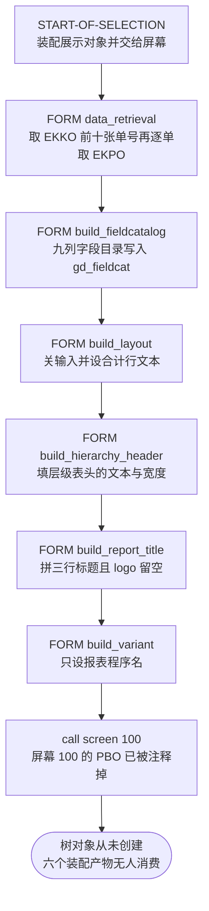
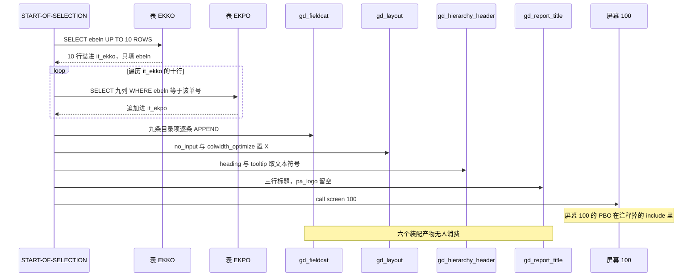

# ZALVTREE 源码分析报告

## 一、程序定位与业务背景

`ZALVTREE` 是一份采购申请（Purchase Order）的 ALV Tree 展示演示程序，它要把扁平的两张表变成"申请单号 → 行项目"两层可展开的树。

业务上，采购经理关心的是"这张申请单下面有哪些行、每行什么物料、单价多少"，而不是把 EKKO 与 EKPO 各刷一屏自己目视对齐。ALV Grid 只能给一张平面表，两级主从关系要靠用户按 `EBELN` 排序后逐行对照；ALV Tree 把这种从属关系编码成节点层级，`EBELN` 做父节点、`EBELN` 加 `EBELP` 做子节点，展开一次就看见整张单。

设计范式是经典的"先装配展示对象、再交给屏幕"：`START-OF-SELECTION` 里只做六件事——取数、建字段目录、建布局、建层级表头、建标题、建变体，然后 `call screen 100.` 把控制权交给屏幕，由屏幕的 PBO 去创建 `cl_gui_alv_tree` 对象并调用显示方法。程序头部的 `ZDEMO_ALVTREEO01`、`ZDEMO_ALVTREEI01`、`ZDEMO_ALVTREEF01` 三个 include 名（O = PBO、I = PAI、F = FORM）说明原本就是按这个分工拆的。

**但这次拿到的不是完整程序**：三个 include 全被注释掉了，而屏幕 100 的 PBO 正是负责建树的那一段。所以这不是一份"有瑕疵的报表"，而是一份只剩取数与装配、没有展示的半成品骨架。后面所有判断都建立在这个事实上——每个装配好的变量都处于"待交付"状态，没有一处被真正消费。

数据面只有 EKKO（采购申请头部）与 EKPO（采购申请行项目）两张 SAP 标准表，没有自建表、没有函数组、没有 OO 实例（`cl_gui_column_tree` 与 `cl_gui_cfw` 只是 `DEFINITION LOAD`，从未产生对象）。这是一份纯经典的报表程序。

## 二、程序执行流程总览



责任链（按执行先后排列）：

| 子程序 | 调用者 | 职责 |
|---|---|---|
| `START-OF-SELECTION` | 选择屏幕执行 | 顺序装配六个展示对象，再 `call screen 100.` |
| `data_retrieval` | `START-OF-SELECTION` | 取 EKKO 前 10 个 `EBELN`，逐个取 EKPO 九列 |
| `build_fieldcatalog` | `START-OF-SELECTION` | 九列 `lvc_t_fcat` 逐条 APPEND 进 `gd_fieldcat` |
| `build_layout` | `START-OF-SELECTION` | 关输入、列宽自适应、合计行文本取文本符号 |
| `build_hierarchy_header` | `START-OF-SELECTION`（CHANGING） | 填 `treev_hhdr` 的标题、提示与宽度 |
| `build_report_title` | `START-OF-SELECTION`（USING） | 拼 H、S、A 三行标题，`pa_logo` 留空 |
| `build_variant` | `START-OF-SELECTION` | 只设 `gd_variant-report` 为 `sy-repid` |
| `call screen 100.` | `START-OF-SELECTION` | 交屏；本程序内没有任何 PBO 或 PAI 接手 |

最后一行值得停下来看：调用链在 `call screen 100.` 就断了。原本接手的三个 include 处于注释状态，所以装配的六个产物全部止于此。

下面按这条流程，逐个子程序展开。

## 三、分组分析（按程序流程 / 子程序）

### 3.1 全局声明区

声明区一口气铺开了整份程序的物料清单。先看两条最老式的写法：

```abap
TABLES: ekko.
TYPE-POOLS: slis. "ALV Declarations
```

**做什么** — `TABLES: ekko.` 把 EKKO 声明成一个全局表变量，`TYPE-POOLS: slis.` 引入 ALV 的类型池，供后面 `slis_layout_alv` 一类结构使用。

**为什么** — `TABLES:` 是老式报表声明，配合 `SELECT * FROM ekko` 使用；类型池是 `slis_*` 结构的来源，当年比一个个声明结构省事。

**风险与改进** — `ekko` 这个表变量在全文没有出现第二次，是一条死声明，删掉不影响任何行为。`TYPE-POOLS` 本身能跑，但已不被推荐，改用本地 `TYPES` 或类加载更可控。

接着是那份窄结构：

```abap
TYPES: BEGIN OF t_ekko,
ebeln TYPE ekpo-ebeln,
ebelp TYPE ekpo-ebelp,
statu TYPE ekpo-statu,
aedat TYPE ekpo-aedat,
matnr TYPE ekpo-matnr,
menge TYPE ekpo-menge,
meins TYPE ekpo-meins,
netpr TYPE ekpo-netpr,
peinh TYPE ekpo-peinh,
END OF t_ekko.
```

**做什么** — 从 EKPO 抽九个数据元素定义本地结构 `t_ekko`：`ebeln` 与 `ebelp` 是单号与行号，`statu` 是行状态，`aedat` 是最后变更日，`matnr` 是物料，`menge` 与 `meins` 是数量与单位，`netpr` 与 `peinh` 是净价与价格单位。

**为什么** — 只把要展示的九列抽成窄结构，避免把 EKPO 两百多个字段整体搬进内存，也让字段目录与内表结构天然对齐。

**风险与改进** — 结构名叫 `t_ekko`，暗示它是 EKKO 的形状，但九个字段全部来自 `ekpo`，名字与内容是反的。下一个维护者读到 `it_ekko TYPE STANDARD TABLE OF t_ekko` 会以为里面装的是申请单头部。建议改名成 `t_ekpo_view` 一类如实的名字。

三张表：

```abap
DATA: it_ekko TYPE STANDARD TABLE OF t_ekko INITIAL SIZE 0,
it_ekpo TYPE STANDARD TABLE OF t_ekko INITIAL SIZE 0,
it_emptytab TYPE STANDARD TABLE OF t_ekko INITIAL SIZE 0,
wa_ekko TYPE t_ekko,
wa_ekpo TYPE t_ekko.
```

**做什么** — 声明三张标准表 `it_ekko`、`it_ekpo`、`it_emptytab` 与两个工作区 `wa_ekko`、`wa_ekpo`，三者都是同一个 `t_ekko` 的标准表，`INITIAL SIZE 0` 表示初始无行也不预留容量。

**为什么** — 标准表加显式工作区是这个年代 ALV 程序的标配，`LOOP AT ... INTO` 需要一个能逐行装载的工作区；`INITIAL SIZE 0` 是显式拒绝旧的自动表头行写法。

**风险与改进** — `it_ekko` 和 `it_ekpo` 共用同一个 `t_ekko`，等于拿 EKKO 的形状去装 EKPO 的数据，与结构名的错位叠加。`it_emptytab` 在全文没有出现第二次，`wa_ekpo` 也没有——这两处是纯死声明。

字段目录的承载体：

```abap
DATA: fieldcatalog TYPE lvc_t_fcat WITH HEADER LINE.

DATA: gd_fieldcat TYPE lvc_t_fcat,
gd_tab_group TYPE slis_t_sp_group_alv,
gd_layout TYPE slis_layout_alv.
```

**做什么** — `fieldcatalog` 是一张带表头行的字段目录表，同时充当逐条填充的工作区；`gd_fieldcat` 是真正接收九条目录项的表；`gd_tab_group` 与 `gd_layout` 分别是分组配置与布局配置。

**为什么** — 老式 ALV 写法习惯用 `WITH HEADER LINE` 的变量当"临时行 + 目标表"两用，`gd_` 前缀表示要交给 ALV 显示函数消费的全局产物。

**风险与改进** — `WITH HEADER LINE` 让 `fieldcatalog` 一个名字同时指表和行，`APPEND fieldcatalog TO gd_fieldcat` 这行的两个操作数方向得靠读代码的人自己分辨。`gd_tab_group` 全文未被使用，可以直接删。

真正决定这份程序性质的是这一段：

```abap
CLASS cl_gui_column_tree DEFINITION LOAD.
CLASS cl_gui_cfw DEFINITION LOAD.

DATA: gd_tree TYPE REF TO cl_gui_alv_tree,
gd_hierarchy_header TYPE treev_hhdr,
gd_report_title TYPE slis_t_listheader,
gd_logo TYPE sdydo_value,
gd_variant TYPE disvariant.
```

**做什么** — 用 `DEFINITION LOAD` 引入 ALV Tree 的两个类，然后声明树对象引用 `gd_tree`、层级表头 `gd_hierarchy_header`、标题行内表 `gd_report_title`、logo 名 `gd_logo` 与变体结构 `gd_variant`。

**为什么** — `DEFINITION LOAD` 只把类的元数据加载进程序，不产生任何实例；引用变量在启动时保持初始状态，等着屏幕的 PBO 去赋对象。

**风险与改进** — `gd_tree` 从未被赋值，`gd_logo`、`gd_variant`、`gd_report_title`、`gd_hierarchy_header` 被填过值但从未被读。这些变量是为将来的 include 预留的，但既然 include 被注释了，它们就是死重量。`DEFINITION LOAD` 本身没有运行时开销，代价是编译器放弃类型检查：等显示那一段真的回来，签名对不对要到运行期才暴露。

最后是容器：

```abap
DATA: l_tree_container_name(30) TYPE c,
l_custom_container TYPE REF TO cl_gui_custom_container.
```

**做什么** — 为 ALV Tree 预留自定义容器名（30 字符字符串）与容器引用 `l_custom_container`。

**为什么** — `cl_gui_alv_tree` 必须挂在一个 `cl_gui_custom_container` 上，而容器由屏幕的块元素定义，所以容器名要在程序里先留好。

**风险与改进** — 两个都是死变量：屏幕 100 的块定义不在本程序里，容器永远不会被创建。

### 3.2 事件块 START-OF-SELECTION

先看被注释掉的三个 include，因为它是理解这份程序的关键：

```abap
*Includes
*INCLUDE ZDEMO_ALVTREEO01. "Screen PBO Modules
*INCLUDE ZDEMO_ALVTREEI01. "Screen PAI Modules
*INCLUDE ZDEMO_ALVTREEF01. "ABAP Subroutines(FORMS)
```

**做什么** — 声明三个 include：`O` 放屏幕 PBO 模块、`I` 放 PAI 模块、`F` 放额外 FORM，三行都以星号开头处于注释状态。

**为什么** — 早期 SAP 演示程序把主程序与屏幕逻辑拆成 include，主程序留声明、屏幕部分单独维护，一份模板可以复用到不同程序。

**风险与改进** — 这三行是整份程序的命门。屏幕 100 的 PBO 就应该是 `ZDEMO_ALVTREEO01`，而它负责创建树对象与显示节点；被注释掉之后，`call screen 100.` 之后的世界在本程序里不存在。修法是二选一：取消注释并确认三个 include 仍在传输中，或者把 PBO 逻辑内联进主程序——后者要重写容器与树的创建，不是删两个星号就完事。这一点在 SE38 里能直接确认：看屏幕 100 的 PBO 事件是否引用了某个模块。

然后是这一段的主体：

```abap
START-OF-SELECTION.

* ALVtree setup data
PERFORM data_retrieval.
PERFORM build_fieldcatalog.
PERFORM build_layout.
PERFORM build_hierarchy_header CHANGING gd_hierarchy_header.
PERFORM build_report_title USING gd_report_title gd_logo.
PERFORM build_variant.
```

**做什么** — 顺序调用六个 FORM：先取数，再依次装配字段目录、布局、层级表头、标题、变体。

**为什么** — 把"准备数据"和"显示"分成两段，这一段只做编排，每个装配步骤都能单独下断点调试，这是 ABAP 报表的标准分工。

**风险与改进** — 六步之间没有任何中间判据：`data_retrieval` 取不回数据也不会中止，后面五步照样装配一张空目录再交屏。建议在取数之后加一步判空，空表时直接 `MESSAGE` 并结束，否则用户看到的是空屏幕，而不是"这次没有数据"的说明。

### 3.3 FORM data_retrieval

这一步分两截：先取申请单号，再逐单取行项目。

#### ① 取申请单号

```abap
FORM data_retrieval.
SELECT ebeln
UP TO 10 ROWS
FROM ekko
INTO corresponding fields of TABLE it_ekko.
```

**做什么** — 从 EKKO 取 `ebeln` 一列，`UP TO 10 ROWS` 截断到 10 行，用 `INTO corresponding fields of TABLE` 装进 `it_ekko`。

**为什么** — 演示程序不需要全量数据，十张就够看树的两层展开；`corresponding fields` 让选择列表与目标表不必完全一致。

**风险与改进** — 两个问题叠加。第一，`WHERE` 条件为空：`UP TO 10 ROWS` 只是截断返回的行数，不约束扫描范围，生产环境上万张申请单时能不能走对索引全靠执行计划。第二，`it_ekko` 是九列的 `t_ekko`，这里只填了 `ebeln`，参考集里 `CORRESPONDING FIELDS OF` 的语义是"只有同名组件才赋值"，所以其余八列全部保持初始值——如果树的第一层用 `it_ekko` 展示，父节点那一行除 `EBELN` 外整行空白。

#### ② 逐单取行项目

```abap
loop at it_ekko into wa_ekko.
SELECT ebeln ebelp statu aedat matnr menge meins netpr peinh
FROM ekpo
appending TABLE it_ekpo
where ebeln eq wa_ekko-ebeln.
endloop.
```

**做什么** — 遍历 `it_ekko` 的十行，每行的 `wa_ekko-ebeln` 都发一次 EKPO 查询，取九列追加进 `it_ekpo`。

**为什么** — 按申请单号分组取行项目，逐单循环最直观，也天然保证 `it_ekpo` 的行顺序与申请单顺序一致。

**风险与改进** — 这是教科书级的 N+1：外层十行对应十次数据库往返，每次 `SELECT` 还各自解析执行计划。改成一条 `FOR ALL ENTRIES IN it_ekko` 就能压成一次往返，代价是要先判空——参考集明确提到 `FOR ALL ENTRIES` 有前提要注意，遇到空表会把条件退化成无条件。另外这里没有检查 `sy-subrc`，某张单在 EKPO 里一行都没有时不会有任何提示，`it_ekpo` 静默少一部分数据。

```abap-fix
SELECT ebeln ebelp statu aedat matnr menge meins netpr peinh
FROM ekpo
appending TABLE it_ekpo
where ebeln IN it_ekko-ebeln.
```

### 3.4 FORM build_fieldcatalog

九列字段目录逐条装配。开头那三行注释是这份程序里最有价值的信息：

```abap
FORM build_fieldcatalog.
* Please not there are a number of differences between the structure of
* ALVtree fieldcatalogs and ALVgrid fieldcatalogs.
* For example the field seltext_m is replace by scrtext_m in ALVtree.
```

**做什么** — FORM 头之后紧接三行注释，说明 ALV Tree 与 ALV Grid 的字段目录结构存在差异，举例是 `seltext_m` 被换成 `scrtext_m`。

**为什么** — 这是踩过坑留下的记录：照着 Grid 的写法改这段不会报错，只会让表头一片空白。

**风险与改进** — 有价值的经验只以散文形式存在，没有变成任何防御手段。建议在正式交付前把它写进程序文档，或者干脆把 `scrtext_m` 的赋值收成一个辅助 FORM，让"用错了字段名"变成一处而非九处。

第一列带了最多的属性：

```abap
fieldcatalog-fieldname = 'EBELN'. "Field name in itab
fieldcatalog-scrtext_m = 'Purchase Order'. "Column text
fieldcatalog-col_pos = 0. "Column position
fieldcatalog-outputlen = 15. "Column width
fieldcatalog-emphasize = 'X'. "Emphasize (X or SPACE)
fieldcatalog-key = 'X'. "Key Field? (X or SPACE)
* fieldcatalog-do_sum = 'X'. "Sum Column?
* fieldcatalog-no_zero = 'X'. "Don't display if zero
APPEND fieldcatalog TO gd_fieldcat.
CLEAR fieldcatalog.
```

**做什么** — 把 `EBELN` 装配成第一条目录项：字段名 `EBELN`、屏幕标题 `Purchase Order`、`col_pos` 取 0、列宽 15、`emphasize` 加粗、`key` 标记为键字段，然后 APPEND 进 `gd_fieldcat` 并 `CLEAR` 工作区。

**为什么** — ALV Tree 的层级列既要承担导航又要承担显示，`emphasize` 与 `key` 一起标记让它在视觉上跳出来。

**风险与改进** — `col_pos` 取 0 值得单独确认：这是九列里唯一取 0 的，其余依次是 1 到 8。在 ALV 的常规语义里 `col_pos` 取 0 意味着该字段不作为列显示、只当取值字段用；如果这个语义在 ALV Tree 上同样成立，`EBELN` 就既当层级键又不出现屏幕上——用户展开节点却看不到单号。ALV Tree 的接口文档不在参考集里，这条需要在 SE38 对照官方文档核一次。

接下来三列是纯样板：

```abap
fieldcatalog-fieldname = 'EBELP'.
fieldcatalog-scrtext_m = 'PO Iten'.
fieldcatalog-outputlen = 15.
fieldcatalog-col_pos = 1.
APPEND fieldcatalog TO gd_fieldcat..
CLEAR fieldcatalog.

fieldcatalog-fieldname = 'STATU'.
fieldcatalog-scrtext_m = 'Status'.
fieldcatalog-outputlen = 15.
fieldcatalog-col_pos = 2.
APPEND fieldcatalog TO gd_fieldcat..
CLEAR fieldcatalog.

fieldcatalog-fieldname = 'AEDAT'.
fieldcatalog-scrtext_m = 'Item change date'.
fieldcatalog-outputlen = 15.
fieldcatalog-col_pos = 3.
APPEND fieldcatalog TO gd_fieldcat..
CLEAR fieldcatalog.
```

**做什么** — 依次装配 `EBELP`（行号）、`STATU`（状态）、`AEDAT`（行项目变更日）三列，列宽统一 15，`col_pos` 依次 1、2、3，各 APPEND 一次后清空工作区。

**为什么** — 三列都是描述性字段，不需要 `emphasize`、`key` 或合计，保持默认即可。

**风险与改进** — 两处。`'PO Iten'` 少了一个 m，是用户直接看得见的表头拼写错误。三处 `APPEND fieldcatalog TO gd_fieldcat..` 末尾是两个点，第二个点是一个独立的空语句；空语句是否被编译器接受，参考集里没有条目，需要编译一次确认，但即使是合法的，也会让语句计数与断点行为变得不可预测。

金额两列最容易被忽略：

```abap
fieldcatalog-fieldname = 'NETPR'.
fieldcatalog-scrtext_m = 'Net Price'.
fieldcatalog-outputlen = 15.
fieldcatalog-col_pos = 7.
fieldcatalog-datatype = 'CURR'.
APPEND fieldcatalog TO gd_fieldcat..
CLEAR fieldcatalog.

fieldcatalog-fieldname = 'PEINH'.
fieldcatalog-scrtext_m = 'Price Unit'.
fieldcatalog-outputlen = 15.
fieldcatalog-col_pos = 8.
APPEND fieldcatalog TO gd_fieldcat..
CLEAR fieldcatalog.
ENDFORM. " BUILD_FIELDCATALOG
```

**做什么** — 装配 `NETPR`（净价，`fieldcatalog-datatype` 显式设为 `CURR`）与 `PEINH`（价格单位）两列，然后 `ENDFORM` 收尾。中间的 `MATNR`、`MENGE`、`MEINS` 三列同样是 `outputlen` 15 的同构样板，此处略过。

**为什么** — 价格是报表里最容易出格式问题的字段，显式指定数据类型能让 ALV 按货币格式渲染。

**风险与改进** — `fieldcatalog-datatype` 设为 `CURR` 只声明了数据类型，货币键要靠 `qfieldname` 指向另一个字段（通常是 `WAERS`）来确定，而这里从未赋值，所以 `NETPR` 按货币格式渲染时拿不到货币键，结果可能是空值或按默认货币显示。另外 `netpr` 的字段类型来自 `ekpo-netpr`，它是否本来就是货币型需要到 SE11 核数据元素定义；如果不是，这个 `datatype` 就是在跟字段真实类型打架。

### 3.5 FORM build_layout

```abap
FORM build_layout.
gd_layout-no_input = 'X'.
gd_layout-colwidth_optimize = 'X'.
gd_layout-totals_text = 'Totals'(201).
* gd_layout-totals_only = 'X'.
* gd_layout-f2code = 'DISP'. "Sets fcode for when double
* "click(press f2)
* gd_layout-zebra = 'X'.
* gd_layout-group_change_edit = 'X'.
* gd_layout-header_text = 'helllllo'.
ENDFORM. " BUILD_LAYOUT
```

**做什么** — 关闭屏幕输入（`no_input`）、开启列宽自适应（`colwidth_optimize`）、把合计行文本设为文本符号 `(201)` 的内容；后面六条是备选项，全部被注释掉。

**为什么** — 树是只读展示，关输入能避免误点；列宽自适应让九列在不同屏幕宽度下不撑爆；合计行文本走文本符号是为了多语言。

**风险与改进** — `'Totals'(201)` 是文本符号写法：值不在代码里，而在程序的编号文本元素里维护，代码里只有编号 201，真正的文字要对着 SE37 的文本编辑器看；201 未维护时的取值行为参考集里没有条目，需要核实。另外 `colwidth_optimize` 打开后 ALV 会按内容重算列宽，前面九列硬写的 `outputlen` 15 在这条生效时基本不起作用——两处配置互相覆盖，留着 15 只是让读代码的人误以为列宽是被控制的。最后 `* gd_layout-header_text = 'helllllo'.` 是测试残留，建议删掉。

### 3.6 FORM build_hierarchy_header

```abap
FORM build_hierarchy_header CHANGING
p_hierarchy_header TYPE treev_hhdr.

p_hierarchy_header-heading = 'Hierarchy Header'(013).
p_hierarchy_header-tooltip = 'This is the Hierarchy Header !'(014).
p_hierarchy_header-width = 30.
p_hierarchy_header-width_pix = ''.
ENDFORM. " build_hierarchy_header
```

**做什么** — 通过 `CHANGING` 参数回填 `treev_hhdr`：标题取文本符号 `(013)`、提示取 `(014)`、`width` 设为 30、`width_pix` 置空。

**为什么** — 层级表头是 ALV Tree 横跨所有列的那一行，用来放整棵树的标题；走文本符号同样是多语言考虑。

**风险与改进** — 与 `build_layout` 同一个问题：`(013)` 与 `(014)` 的实际文本不在代码里，维护者改代码改不到这些文字。`width` 与 `width_pix` 两个宽度属性一个给字符数、一个给像素数，同时出现时以谁为准取决于 ALV Tree 的实现，建议只留一个。参数侧 `CHANGING` 与调用侧 `CHANGING` 一致，语义清晰，没有问题。

### 3.7 FORM build_report_title

这个 FORM 有三段标题，先看签名与局部声明：

```abap
FORM build_report_title CHANGING
pt_report_title TYPE slis_t_listheader
pa_logo TYPE sdydo_value.

DATA: ls_line TYPE slis_listheader,
ld_date(10) TYPE c.
```

**做什么** — 通过 `CHANGING` 接收标题行内表与 logo 名，局部声明一行工作区 `ls_line` 和一个 10 字符的日期缓冲 `ld_date`。

**为什么** — 标题行是 `slis_t_listheader` 内表，要逐行装；日期用定长字符缓冲做字符位运算，避开日期格式化工具的依赖。

**风险与改进** — `pa_logo` 声明为 `CHANGING` 却在全文一次都没有被赋值，所以交出去的 `gd_logo` 还是初始值空格，标题栏的 logo 位是空的。要么补一行赋值指定图形名，要么把这个参数删掉——留着一个空的 `CHANGING` 参数会让人误以为 logo 是被设置过的。

主标题与日期拼装：

```abap
* List Heading Line(TYPE H)
CLEAR ls_line.
ls_line-typ = 'H'.
* ls_line-key "Not Used For This Type(H)
ls_line-info = 'PO ALVTree Display'.
APPEND ls_line TO pt_report_title.
```

**做什么** — 第一行用 `ls_line-typ` 取 `H` 放主标题 `PO ALVTree Display`，`CLEAR` 一次后赋 `info` 再 APPEND。

**为什么** — `slis_listheader` 的 `typ` 决定行的版式：H 是大标题、S 是状态、A 是操作说明。

**风险与改进** — 这行 `* ls_line-key` 注释本身在说 H 型不用 `key`，说明作者知道规则。但 `'PO ALVTree Display'` 是硬编码英文，与同一个程序里 `build_layout`、`build_hierarchy_header` 走文本符号的做法自相矛盾。

```abap
* Status Line(TYPE S)
ld_date(2) = sy-datum+6(2).
ld_date+2(1) = '/'.
ld_date+3(2) = sy-datum+4(2).
ld_date+5(1) = '/'.
ld_date+6(4) = sy-datum(4).
```

**做什么** — 用字符位切分把 `sy-datum`（YYYYMMDD）重排成 `DD/MM/YYYY` 塞进 `ld_date`：取日、插斜杠、取月、插斜杠、取年。

**为什么** — 手写日期是为了兼容不需要日期格式化工具的老系统，避免引入额外的转换调用。

**风险与改进** — 这是整段最脆的地方：`ld_date` 声明长度 10，实际只用到前 8 位，末尾两位永远为空，字符串带着两个尾随空格参与显示。更直接的问题是格式写死成 `DD/MM/YYYY` 而同一份程序的表头文本是英文——本地化口径不统一。这一整段可以换成一条 `WRITE sy-datum TO ld_date FORMAT DD/MM/YYYY.`，语义一目了然。

然后是顺序上的细节：

```abap
ls_line-typ = 'S'.
ls_line-key = 'Date'.
ls_line-info = ld_date.
APPEND ls_line TO pt_report_title.
```

**做什么** — 装第二行状态行，`key` 放 `Date`、`info` 放拼好的日期字符串。

**为什么** — S 型的 `key` 是标签、`info` 是值，这是标准配对。

**风险与改进** — 这一段之前没有 `CLEAR ls_line`：它依赖"上一轮只设过 `typ`、`key`、`info` 三个字段"这个巧合来保证不串行。今天确实安全，但 `slis_listheader` 还有 `space`、`key_left`、`info_len`、`color` 等一堆字段，一旦 H 行将来多设一个，S 行会静默继承它。补一行 `CLEAR ls_line.` 成本是零。

最后一段：

```abap
* Action Line(TYPE A)
CLEAR ls_line.
ls_line-typ = 'A'.
CONCATENATE 'Report: ' sy-repid INTO ls_line-info SEPARATED BY space.
APPEND ls_line TO pt_report_title.
ENDFORM. " BUILD_VARIANT
```

**做什么** — 第三行操作说明，用 `CONCATENATE` 把 `Report: ` 与当前程序名 `sy-repid` 拼成 `ZALVTREE`，然后 `ENDFORM` 收尾。

**为什么** — 让用户在屏幕上确认自己看的是哪份程序，演示程序常用这一手。

**风险与改进** — 两处。`'PO ALVTree Display'`、`'Date'`、`'Report: '` 三处界面文本都是硬编码英文，而同一程序已经在用 `(013)`、`(014)`、`(201)` 三种文本符号，口径不统一。更隐蔽的是结尾注释写成 `ENDFORM. " BUILD_VARIANT`，而它实际处在 `build_report_title` 的结尾——这是复制粘贴留下的痕迹，会让读者以为两个 FORM 是连着的。

```abap-fix
WRITE sy-datum TO ld_date FORMAT DD/MM/YYYY.
```

### 3.8 FORM build_variant

```abap
form build_variant.
* Set repid for storing variants
gd_variant-report = sy-repid.
endform. " BUILD_VARIANT
```

**做什么** — 把全局变体结构的 `gd_variant-report` 设为当前程序名 `sy-repid`，然后 `endform` 收尾。

**为什么** — 保存 ALV 变体时要把 `disvariant` 传给显示函数，`report` 字段告诉系统变体挂在哪个程序名下。

**风险与改进** — 注释说 "Set repid for storing variants"，但 `gd_variant-variant` 从未赋值，所以这实际上是一个默认变体，并不打算保存某个有名变体；注释与代码不符。更根本的问题是 `gd_variant` 从头到尾没有被任何显示调用消费，和 `gd_tree`、`gd_logo` 一样属于"装配好但没交付"。

### 3.9 装配结果的去向

上面八个分组走完，`START-OF-SELECTION` 装配的所有东西最终落在这里：

```abap
* Display ALVtree report
call screen 100.
```

**做什么** — 交出控制权给屏幕 100，本程序在这一点结束。

**为什么** — ALV Tree 必须挂在屏幕的自定义容器上，而容器由屏幕块定义，所以显示动作天然要在屏幕的 PBO 里做。

**风险与改进** — 这是整份报告的收口：`gd_fieldcat` 的九列目录、`gd_layout` 的布局、`gd_hierarchy_header` 的层级表头、`gd_report_title` 的三行标题、`gd_logo`、`gd_variant`——六个产物在这个语句之后没有任何读者。它们不是"用错了"，而是"没人用"。要让这份程序真正跑起来，缺的不是修几行代码，而是把屏幕 100 的 PBO 拿回来并在其中创建树对象与显示节点。

## 四、执行流程全景图（数据视角）



数据流在这张图里断得很清楚：EKKO 与 EKPO 的取数完成了，六个装配对象也完成了，但没有任何一条箭头从装配对象指向树的显示。

## 五、问题清单与改进建议（按优先级）

### 🔴 P0 业务正确性

| 编号 | 问题 | 所在位置 | 业务后果 |
|---|---|---|---|
| P0-1 | 三个 include 被注释，屏幕 100 的 PBO 缺失，`gd_tree` 从未创建 | 全局声明区、事件块 START-OF-SELECTION | 程序跑完只显示空屏幕，六个装配产物全部作废；用户看到的不是申请单树，而是一张空屏 |
| P0-2 | `it_ekko` 只取 `ebeln` 一列，`CORRESPONDING FIELDS OF` 按同名组件赋值，其余八列恒为初始值 | FORM data_retrieval | 树的第一层节点除 `EBELN` 外整行空白，父子从属关系在视觉上断了 |
| P0-3 | 取 EKKO 无 `WHERE` 条件，`UP TO 10 ROWS` 只截断返回行数 | FORM data_retrieval | 生产环境取到的十张与用户想看的那张没有任何关系 |

### 🟠 P1 健壮性

| 编号 | 问题 | 所在位置 | 业务后果 |
|---|---|---|---|
| P1-1 | 读 `ekko` 与 `ekpo` 全文无 `AUTHORITY-CHECK` | FORM data_retrieval | 报表跑在 `S_TCODE` 授权下，任意能运行这个事务码的用户都可以看到全量采购申请数据，无数据权限隔离；采购与仓库的职责分离在这份程序里不存在 |
| P1-2 | 外层十行对应十次 EKPO 往返，且未检查 `sy-subrc` | FORM data_retrieval | 某张单在 `it_ekpo` 里没有行时静默丢数据，树缺分支也不提示 |
| P1-3 | `pa_logo` 声明为 `CHANGING` 却从未赋值 | FORM build_report_title | 标题栏 logo 位为空，屏幕看起来像未初始化 |
| P1-4 | `gd_layout-totals_text` 与 `p_hierarchy_header-heading` 等三处文本符号的实际文本不在代码里 | FORM build_layout、FORM build_hierarchy_header | 改代码的人改不到这些文字，改文字的人看不到代码 |

### 🟡 P2 性能与规范

| 编号 | 问题 | 所在位置 | 改进方向 |
|---|---|---|---|
| P2-1 | `fieldcatalog-col_pos` 只有 `EBELN` 取 0，其余 1 到 8 | FORM build_fieldcatalog | 对照 ALV Tree 文档确认 `col_pos` 取 0 是否意味着该列不显示 |
| P2-2 | `fieldcatalog-datatype` 设为 `CURR` 但没有货币键 | FORM build_fieldcatalog | 补一个 `qfieldname` 指向货币字段，或确认字段本身不是货币型后去掉该属性 |
| P2-3 | `WITH HEADER LINE` 让一个名字同时指表与行 | 全局声明区 | 改成显式工作区，避免 `APPEND` 的方向混淆 |
| P2-4 | 八处 `APPEND fieldcatalog TO gd_fieldcat..` 双点结束 | FORM build_fieldcatalog | 删掉第二个点；空语句是否被接受需编译确认 |
| P2-5 | S 行装配前缺 `CLEAR ls_line`，靠字段覆盖巧合不串行 | FORM build_report_title | 补一行 `CLEAR ls_line.` |
| P2-6 | 九列 `outputlen` 与 `colwidth_optimize` 互相覆盖 | FORM build_fieldcatalog、FORM build_layout | 二选一：删掉自适应或删掉全部列宽 |
| P2-7 | 日期手拼 `DD/MM/YYYY`，`ld_date` 末尾留两位空格 | FORM build_report_title | 换成一条 `WRITE` 加 `FORMAT` |

### 🟢 P3 可扩展性

| 编号 | 问题 | 所在位置 |
|---|---|---|
| P3-1 | 死声明：`it_emptytab`、`wa_ekpo`、`gd_tab_group`、`l_custom_container` 与 `TABLES` 声明的 `ekko` | 全局声明区 |
| P3-2 | 装配好但无人消费：`gd_tree`、`gd_logo`、`gd_variant`、`gd_report_title`、`gd_hierarchy_header`、`gd_layout` | 全局声明区、事件块 START-OF-SELECTION |
| P3-3 | `'PO ALVTree Display'`、`'Date'`、`'Report: '` 硬编码英文，与文本符号口径不一致 | FORM build_report_title |
| P3-4 | 表头标题 `'PO Iten'` 拼写错误 | FORM build_fieldcatalog |
| P3-5 | 结尾注释 `ENDFORM. " BUILD_VARIANT` 标在 `build_report_title` 处 | FORM build_report_title |
| P3-6 | 变体只设 `report` 未设 `variant`，实为默认变体，注释却写 storing variants | FORM build_variant |
| P3-7 | `form build_variant.`、`call screen 100.`、`loop at` 大小写与其余不一致；`gd_layout-header_text` 测试残留未删 | 事件块、FORM build_variant、FORM build_layout |

## 六、整体评价与启发

**优点**

- 装配段做得规整：六个 FORM 各自单一职责，`START-OF-SELECTION` 只当编排器，"主程序只做调度"这个写法在报表里值得抄。
- 留了三条踩过坑才写得出来的经验：ALV Tree 与 Grid 字段目录的差异、`f2code` 的用法、层级表头走文本符号。
- 字段目录逐条 `APPEND` 加 `CLEAR` 的写法比一次构造整张表更好读，演示场景下尤其合适。

**短板**

- 最大的短板不是代码质量，而是交付完整性：把屏幕逻辑注释掉的演示程序，会让读者获得"这份代码看起来没问题"的错误信心。
- 类型命名与内容错位（`t_ekko` 装 EKPO、`it_ekko` 装单号）会让下一个维护者反复怀疑自己读错了。
- 文本处理三种口径混用：文本符号、硬编码英文、注释里的英文。

**可学到的设计经验**

- 装配与展示分离是对的，但装配完必须有人接。每个 `CHANGING` 参数都应该能在下游找到读者，找不到读者的参数就是死代码。
- N+1 查询在演示程序里最危险，因为它跑起来完全没问题，等换成真实数据量才暴露。`FOR ALL ENTRIES` 不是性能技巧，而是把"逐行发请求"这个结构错误一次性消掉。
- 权限检查不是可选项：读了采购主数据却没有任何检查，等于把数据权限完全交给角色配置——角色配对了没问题，配错了就是越权。
- 注释是廉价的文档，断言才是防御。`col_pos` 取 0 这类"看着像故意的"写法值得配一行说明；`ENDFORM. " BUILD_VARIANT` 这类标错的注释，则说明复制粘贴之后没有人回读过。

---

覆盖范围：本程序共 7 个子程序（1 个事件块加 6 个 FORM），完整展开 9 个分组（3.1 全局声明区与 3.9 装配结果的去向为跨分组视角），无遗漏。
